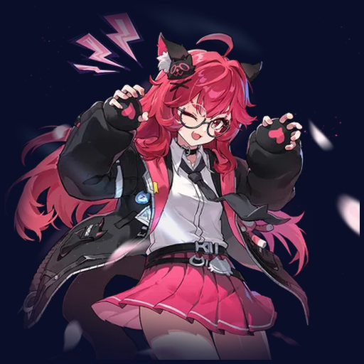
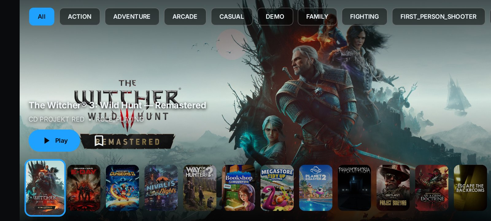

<p align="center">
  
</p>

<h1 align="center">NanaPlay</h1>

<p align="center">
  <strong>GeForce NOW on Android, with a console feel.</strong><br>
  An open-source Android client for GeForce NOW, rebuilt around how people actually play on phones.
</p>

<p align="center">
  <a href="https://github.com/FahriAdison/NanaPlay/releases/latest">Downloads</a> ·
  <a href="#features">Features</a> ·
  <a href="#building">Build from source</a> ·
  <a href="#changelog-recent">Changelog</a> ·
  <a href="#community">Community</a>
</p>

<p align="center">
  <a href="https://github.com/FahriAdison/NanaPlay/releases/latest">
    
  </a>
</p>

<p align="center">
  
  
  
  <a href="https://discord.gg/TyBrNKnavR">
    
  </a>
</p>

---

NanaPlay is a community fork of [OpenNOW](https://github.com/OpenCloudGaming/OpenNOW) by [Zortos](https://github.com/OpenCloudGaming), recoded for Android by **Papah Chan** ([FahriAdison](https://github.com/FahriAdison)).

It keeps OpenNOW's GeForce NOW streaming core and builds a console-style experience on top: a PS5-inspired interface, touch controls you can rearrange freely, smarter queue handling, and tuning for players on slower or unstable networks.

> **Beta status.** NanaPlay is tested on real devices and works, but it's still beta — expect some rough edges. Bug reports are welcome in [Issues](https://github.com/FahriAdison/NanaPlay/issues) or on Discord.

> **You need your own GeForce NOW account.** Your subscription tier and region determine which games and stream settings are available to you.

---

## Download

Grab the latest APK from the [Releases page](https://github.com/FahriAdison/NanaPlay/releases/latest). The in-app updater will notify you when a new version is out.

- **Package:** `com.papahchan.nanaplay` — different from upstream OpenNOW, so both can be installed side-by-side.
- If you previously installed a NanaPlay build under the old package (`com.opencloudgaming.opennow`), uninstall it first. Your GeForce NOW login is server-side, so just sign in again.

---

## Screenshots

<p align="center">
  
</p>
<p align="center"><em>Console Mode — PS5-style interface in landscape</em></p>

---

## Features

**Play your way**
- **Console Mode** — PS5-style interface: game artwork backdrops, horizontal card strips, D-pad navigation, immersive fullscreen landscape and portrait layouts.
- **Custom touch layout** — drag buttons and sticks anywhere in edit mode, lock the layout to prevent accidents, reset with confirmation.
- **Quick Bar** — floating in-stream menu for screenshots, recording, the floating browser, music, keyboard, and touch-control toggles.
- **Custom overlay shortcut** — remap the overlay trigger (START/SELECT, Guide, L1+R1, L3+R3…) with adjustable hold timing.

**Built for real networks**
- **Queue redesign** — route picker with ping bars, fullscreen queue position screen with live countdown.
- **Persistent reconnect** — optional unlimited auto-reconnect with backoff, plus automatic fallback to a low-bandwidth profile for connections under ~4 Mbps.
- **Adaptive network adjustment** — automatic quality/latency tuning based on measured conditions.

**Extras**
- **Music player** — local files plus online streaming, with notification and lock-screen controls; works outside and inside the stream.
- **Floating browser** — lightweight WebView over the stream for maps and guides.
- **Stream recording & screenshots** — record to MP4, capture PNGs.
- **Low-latency audio toggle**, **maintenance/patching banners** with pre-play confirmation, in-app announcements.

---

## Building

Requirements: **JDK 17**, Android SDK (compileSdk 37), Gradle 9.x.

```bash
cd android
./gradlew assembleRelease
```

The APK lands in `android/app/build/outputs/apk/release/`. Release builds use R8 minification and resource shrinking.

> **Signing:** release builds expect a keystore configured as the `nanaplay` signing config. Never commit keystores — see `.gitignore`.

Repository layout:

```
.
├── android/                  # Android app (Kotlin + Jetpack Compose)
│   └── app/src/main/
│       ├── java/com/opencloudgaming/opennow/
│       │   ├── Nana*.kt      # NanaPlay features (music, browser, announcements…)
│       │   └── OpenNow*.kt   # Upstream base (streaming, queue, auth…)
│       └── res/              # Resources
├── announcements.json        # In-app announcement feed
├── nanaplay-icon.png         # App icon
├── screenshot-console.png    # Console Mode screenshot
├── README.md
└── LICENSE
```

---

## Changelog (recent)

| Version | Highlights |
|---------|------------|
| 1.0.80 | Fixed touch-layout edits being wiped when dragging the quick bar, keyboard bar, or control panel |
| 1.0.79 | Layout lock toggle + reset confirmation; analog stick auto-recenter |
| 1.0.78 | Fixed false APK signature-mismatch error on Android 9 |
| 1.0.77 | Customizable overlay shortcut; updated About page |
| 1.0.76 | Maintenance/patching warning banner with pre-play confirmation |
| 1.0.75 | Session management (ported from upstream) |
| 1.0.74 | Browser panel drag fix; queue dock in portrait console mode |
| 1.0.72 | Adaptive network adjustment; mouse-to-touch-drag for NTE |
| 1.0.71 | Music player hardening: repeat/shuffle, notification controls, call auto-pause |
| 1.0.20 | New package `com.papahchan.nanaplay`; first GitHub release |
| 1.0.19 | Persistent reconnect for poor networks |
| 1.0.10 | First Console Mode |

---

## Community

Chat with other players, share feedback, and get help on the **NanaPlay Community** Discord:

<p align="center">
  <a href="https://discord.gg/TyBrNKnavR">
    
  </a>
</p>

---

## Support

NanaPlay is free and open-source, built in spare time with the community. If it makes your cloud gaming better, consider supporting development:

<p align="center">
  <a href="https://sociabuzz.com/papahchan/tribe">
    
  </a>
</p>

---

## Credits

- **Upstream:** [OpenNOW](https://github.com/OpenCloudGaming/OpenNOW) by [Zortos](https://github.com/OpenCloudGaming) — the foundation of everything here. Android contributions by [Kief5555](https://github.com/Kief5555).
- **Recode & redesign:** [Papah Chan](https://github.com/FahriAdison)
- **Online music:** [JioSaavn](https://www.jiosaavn.com) catalog via the ShnwazDev public API wrapper (based on [sumitkolhe/jiosaavn-api](https://github.com/sumitkolhe/jiosaavn-api), MIT).

## Disclaimer

NanaPlay is an independent community project. It is not affiliated with, endorsed by, or sponsored by NVIDIA. GeForce NOW is a trademark of NVIDIA Corporation.

## License

MIT License — see [LICENSE](LICENSE). Original copyright (c) 2025 Zortos, retained as required by the license.
